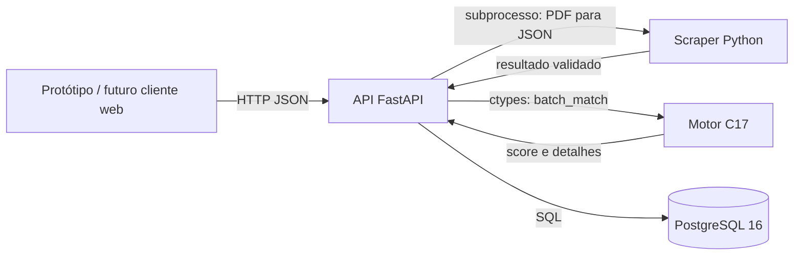

# Sprint 02 - Arquitetura e Modelagem do Sistema

Este diretório acompanha o documento técnico da Sprint 02. O planejamento da
Sprint 01 continua como base para os requisitos RF01-RF10 e para o backlog.

## Arquitetura

A API é atualmente Python/FastAPI. Seus contratos HTTP, modelos de dados e
fronteira com o motor permitem substituir sua implementação futuramente,
inclusive por C, sem exigir alteração conceitual do banco ou do algoritmo.
O scraper extrai texto nativo com regras e expressões regulares; OCR e classificação probabilística não integram a versão atual.
O matching em C é determinístico: pesos, relações direcionadas, threshold e
ordenação estão detalhados no [README do motor](../../Matching-ariano-c/matching_engine/README.md).

## Modelagem

O [modelo relacional completo](modelo-relacional.md) foi derivado de
[`api/db/schema.sql`](../../api/db/schema.sql): 12 tabelas e 74 colunas,
com tipos, PKs, FKs, nulabilidade e defaults. A extensão do MER inicial inclui
`tb_documents`, campos de prazo/orçamento/moeda em `tb_demands` e
`algorithm_version` em `tb_matches`; essas extensões preservam o fluxo de
editais e a rastreabilidade do matching.

## Protótipo

[Figma - ARIANO Sprint 02](https://www.figma.com/design/jDNDjUvQkZThCV0GjjFukV)
contém painel, envio/revisão de edital, ranking explicável e cadastro de ator.
As telas são protótipos e ainda não consomem os endpoints.

## Execução e evidência

O banco é definido por [`schema.sql`](../../api/db/schema.sql), recebe dados de
exemplo de [`seed.sql`](../../api/db/seed.sql) e é provisionado pelo
[`docker-compose.yml`](../../api/docker-compose.yml). A
[evidência de banco](evidencia-banco.txt), com
[saída bruta preservada](evidencia-banco-bruta.txt), registrada em 29/09/2026, mostra
PostgreSQL 16.14 saudável e consulta real ao `information_schema`: 12 tabelas,
74 colunas, 4 atores e 1 demanda. A data é posterior ao prazo de 19/09/2026.
Essa verificação comprova o banco criado e populado. A API foi verificada em
uma execução separada.

O [teste integrado da API](../../api/scripts/smoke_api.py) foi executado com
os serviços em contêineres saudáveis. O [registro da execução](evidencia-api-bruta.txt)
mostra `/health` com banco e motor OK, upload de PDF, cadastro de ator e demanda,
matching com score 0,9 e consulta do resultado persistido. O procedimento para
repetir o teste está no [README da API](../../api/README.md). Uma
[execução ampliada](evidencia-api-ampliada.txt) também confirmou respostas 404,
rejeição de peso inválido e de PDF corrompido.

O Scrum Master é Raul Anthony de Sousa Muniz. O número do grupo será preenchido
pela equipe antes do envio ao Teams.

