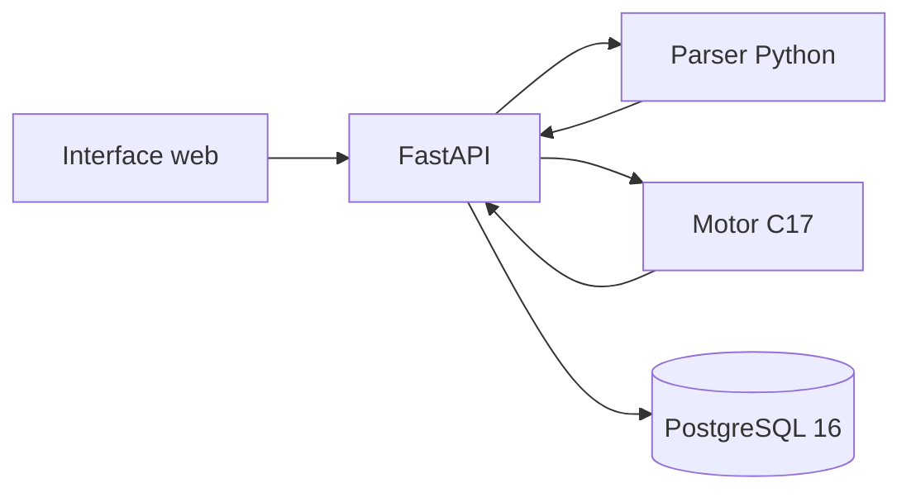

# Documentação consolidada do ARIANO

Esta referência descreve o sistema disponível na Sprint 11. A Release Candidate da Sprint 10 continua disponível pela tag v1.0.0-rc.1. A revisão posterior preserva a interface e o contrato HTTP e normaliza o nome de origem do PDF antes de persistir os metadados de novos envios.

## Requisitos, casos de uso e regras

| Referência | Implementação atual |
|---|---|
| RF01–RF04, UC02 e UC06 | Catálogo de tags e relações pela API. Cadastro, consulta, edição e exclusão dos atores na interface. As competências do ator usam peso entre 0 e 1. |
| RF05–RF07, UC01 e UC03 | Upload, extração, deduplicação por hash, revisão humana e persistência de oportunidades. Demandas precisam de ao menos uma competência com peso positivo. |
| RF08–RF10, UC04 e UC05 | Matching, opções de limiar e top-k, ranking versionado e explicação por competência. Alterar critérios invalida os resultados. Encerrar preserva a consulta e bloqueia o recálculo até a reabertura. |
| Consultas e auditoria | Dashboard, busca, filtros, CSV e histórico. Editor e Administrador consultam eventos e apenas Administrador gerencia papéis. |
| Requisitos não funcionais | Separação entre API, parser e motor, cálculo determinístico, integridade relacional, migrações, autenticação e testes. A validação desta entrega foi local. |

## Arquitetura e modelo de dados

| Conjunto | Relações principais |
|---|---|
| Atores e catálogo | tb_actors tem quatro subtipos. tb_actor_tags associa ator e tag. tb_tag_relationships liga tags por origem e alvo. |
| Editais e demandas | tb_documents guarda hash e JSON. tb_demands referencia solicitante e documento. tb_demand_tags liga demanda e competência. |
| Matching | tb_matches referencia demanda e ator e guarda versão, score e explicação. |
| Contas e eventos | tb_users, tb_sessions e tb_operation_log sustentam sessões, perfis e histórico. |

O schema executável e as migrações são a referência do banco. Consulte [DDL](../../api/db/schema.sql), [migrações](../../api/db/migrations/), [guia de funcionamento](../../COMO_FUNCIONA.md) e [contrato HTTP](../API.md). O diagrama relacional da Sprint 02 retrata aquela etapa. O modelo atual soma autenticação, catálogo alinhado à extração e histórico.

## Limites e continuidade

Editais sem camada textual podem exigir revisão manual. OCR e coleta remota automática ficam como evoluções futuras. A validação do ambiente de apresentação e do acesso de avaliadores à implantação fica para o ensaio final.
