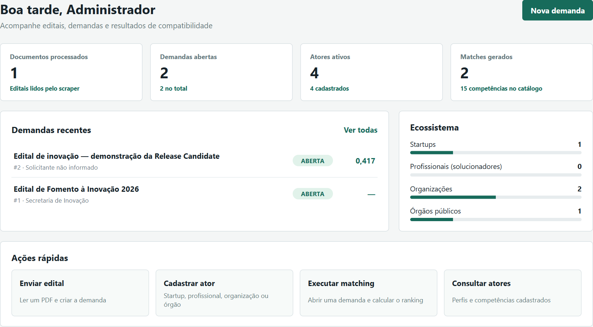
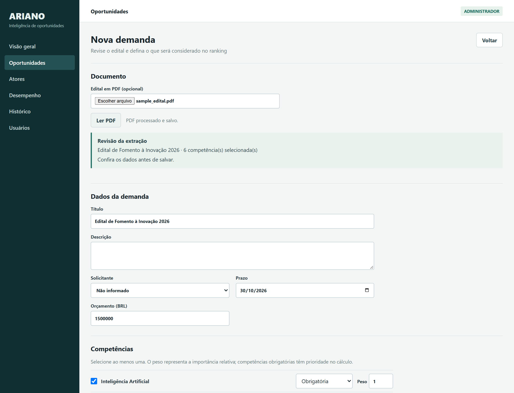
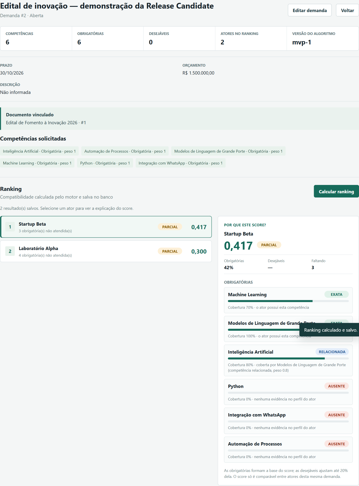
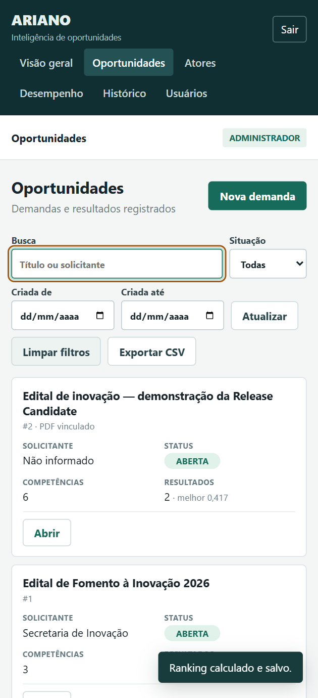

# Manual do Usuário

## Para que serve o ARIANO

O ARIANO ajuda a equipe a transformar um edital em uma oportunidade e a encontrar atores com competências compatíveis. O ranking mostra a pontuação e explica quais competências contribuíram para cada resultado. O sistema é voltado a equipes de inovação de órgãos públicos e organizações, profissionais, startups e pessoas que administram os dados do projeto.

## Acesso e perfis

Abra a URL da aplicação indicada pela equipe. Em uma instalação local padrão, use http://localhost:8000/app/. Selecione **Criar conta**, preencha nome, e-mail e senha de pelo menos 12 caracteres. Depois escolha **Entrar**. Use **Sair** no menu quando terminar.

| Perfil | Ações disponíveis |
|---|---|
| Leitor | Consulta painel, atores, oportunidades e rankings. Pode filtrar e exportar o CSV de oportunidades. |
| Editor | Também cadastra e edita atores e oportunidades, envia editais, calcula rankings e consulta o histórico. |
| Administrador | Realiza as ações do Editor e gerencia papéis de usuários. |

O cadastro público cria uma conta Leitor. Para receber permissão de edição, solicite a alteração a um administrador.

## Visão geral

O painel mostra documentos processados, demandas abertas, atores ativos e resultados registrados. Selecione uma demanda recente para abrir o detalhe ou use **Enviar edital** para iniciar o cadastro.

## Cadastrar ator e competências

1. Abra **Atores** e escolha **Novo ator**.
2. Selecione o tipo, informe o nome e preencha os demais dados pertinentes ao perfil.
3. Selecione as competências do ator e informe a força de cada uma entre 0 e 1.
4. Salve. Use a busca para localizar o registro por nome, cidade ou tipo. Um Editor ou Administrador pode editar ou excluir, respeitando os vínculos da base.

## Criar oportunidade e revisar o edital

1. Em **Oportunidades**, escolha **Nova demanda**. Para partir de um edital, selecione um PDF de até 10 MB e pressione **Ler PDF**.
2. Confira o título, o prazo e o orçamento quando o sistema conseguir extraí-los. Revise as competências sugeridas. Também é possível preencher tudo manualmente.
3. Selecione pelo menos uma competência, marque cada uma como obrigatória ou desejável e atribua um peso positivo. Informe os demais dados pertinentes, como solicitante e descrição.
4. Selecione **Salvar e ver ranking** e confira o detalhe da oportunidade. Se usou PDF, verifique o documento vinculado.

## Calcular e interpretar o ranking

1. Abra uma oportunidade aberta ou em análise e pressione **Calcular ranking**.
2. Selecione um ator. O painel **Por que este score?** mostra requisitos obrigatórios e desejáveis, cobertura e evidências exatas, relacionadas ou ausentes.
3. Compare pontuações dentro da mesma demanda. Use **Voltar** para recuperar o ranking depois pela lista.
4. Use **Editar demanda** para corrigir dados, encerrar ou reabrir. Encerrar mantém os resultados consultáveis. Reabra antes de calcular novamente. Alterar competências, tipos ou pesos invalida o ranking anterior.

## Consultar relatório, exportar e acompanhar operações

Em **Oportunidades**, combine a busca por título ou solicitante, a situação e as datas de criação. Use **Limpar filtros** para recuperar a lista e **Exportar CSV** para baixar a seleção. O arquivo usa separador ponto e vírgula.

Editor e Administrador podem abrir **Histórico** para ver as últimas 100 operações registradas. Em **Usuários**, o Administrador altera papéis. **Desempenho** permite comparar tempos de execução sequencial e paralela com dados de teste.

## Mensagens e situações comuns

| Situação | O que fazer |
|---|---|
| E-mail ou senha inválidos | Confira os dados e tente entrar novamente. |
| Sessão expirada ou acesso negado | Faça login novamente se a sessão expirou. Para uma ação restrita, confira seu perfil. |
| Título curto ou nenhuma competência | Use pelo menos três caracteres no título e selecione ao menos uma competência. |
| PDF inválido ou leitura incompleta | Use um PDF íntegro de até 10 MB. Edite os campos que faltarem. PDFs digitalizados podem trazer resultado vazio ou parcial. |
| PDF já registrado | Revise os dados recuperados do documento existente e continue. |
| Período inválido | Informe data inicial igual ou anterior à final. |
| Oportunidade encerrada | Abra o ranking salvo para consulta. Um perfil autorizado pode reabrir a demanda antes de recalcular. |
